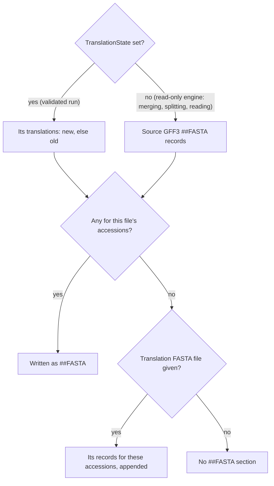

- Feature Name: `annotation_scoped_fasta_writing`
- Document Date: 2026-09-07
- Last Updated: 2026-11-25

# Summary

A written GFF3 document has **one** `##FASTA` section, after its last annotation. It holds the
translations of **that document's annotations only**.

Translations come from three places:

1. **`translationState`**: what validation recorded. Per feature it holds an *old* translation (the
   submitted one: `##FASTA`, else the `translation=` attribute) and a *new* one (generated by
   `TranslationFix`).
2. **The source GFF3's own `##FASTA`** (read via `gff3Reader`).
3. **`fastaFilePath`**: a translation FASTA the caller supplied.

**Sources 1 and 2 are never combined.** With a `translationState`, only its translations are
written and the source file isn't read again: validation already recorded every submitted
`##FASTA` protein that belongs to a feature. Without one (a read-only engine, or a caller that
passes none), the source `##FASTA` records are copied as they are. Source 3 is used only when that
gives nothing for the whole document.

So for one feature the written protein is **new, else old** when there is a state, and the source
`##FASTA` record when there isn't.

# Motivation & Rationale

- **One `##FASTA`, at the end.** `##FASTA` ends the feature section, so a section between
  annotations would hide every annotation after it.
- **Scoped to the document.** A subset of a submission (e.g. one group when splitting) must carry
  exactly its own translations, so every source is filtered to the document's accessions.
- **What is written is what was validated.** After validation the state holds both the submitted
  and the generated proteins, so writing it alone guarantees the output matches what was checked.
- **The source `##FASTA` is still needed without validation.** Merging or splitting already
  validated files runs a read-only engine, which has no state; the source `##FASTA` is then the
  only copy of the translations.

# Usage Guidelines

```java
GFF3File.builder()
        .header(header)
        .species(species)
        .annotations(annotations)
        .gff3Reader(reader)                  // any of the three sources, all optional
        .translationState(translationState)
        .fastaFilePath(fallbackFasta)
        .writeAnnotationFasta(true)          // defaults to false = no ##FASTA at all
        .build()
        .writeGFF3String(writer);
```

- **`writeAnnotationFasta`** means "write translations". `false` gives a features-only document
  even when sources are set. `GFF3FileFactory.from`, `ValidationCommand`, `TranslationCommand` and
  the TSV converter pass `true`. `fromAnnotationAndReader` passes on whatever the caller chose.
- **Nothing anywhere means no `##FASTA` line.** An empty section is never written.
- **The backup is all-or-nothing per document.** If any feature got a translation from sources 1
  or 2, `fastaFilePath` isn't read. A missing, empty or unrelated file is logged and gives nothing;
  the write doesn't fail.

**Scoping.** In `fastaFilePath` and the source `##FASTA`, a record is kept by the accession in its
`>accession|featureId` header. Any other header shape is dropped and logged.

**Matching is exact**, version included: `AB123.1` never matches `AB123.10`, and an accession
without a version matches nothing. A missing translation is easy to spot, a misattributed one isn't.

**Which translation a feature gets:**

| Step | Source | When it is there |
|---|---|---|
| 1 | `TranslationState` new | `TranslationFix` translated the CDS: sequences given, `TRANSLATION` fix on, not pseudo. For an `exception` CDS the fix copies old into new |
| 2 | `TranslationState` old | The submitted protein: the `##FASTA` record, else the `translation=` attribute. Recorded by `TRANSLATION_ATTRIBUTE_FASTA_MISMATCH` (HIGH); `REMOVE_TRANSLATION_ATTRIBUTE` (NORMAL) records the attribute only if nothing is recorded yet |
| 3 | Source `##FASTA` | Only when there is no `translationState` at all. Then every record of the document's accessions is copied, including records no feature claims |
| 4 | `fastaFilePath` | Only when steps 1 to 3 give nothing for the **whole** document |

With a state, a `##FASTA` record that no feature claims is not written: it never reaches the state,
and `FASTA_TRANSLATION_WITHOUT_FEATURE` fails validation for it.

**An old translation without a new one** is written as it is (step 2), but validation decides
whether that is acceptable. `TRANSLATION_COMPARISON` compares old with new:

| Situation | New translation | Validation |
|---|---|---|
| No sequences given | none | passes: nothing to compare, the submitted protein is kept |
| `exception` CDS | = old | passes: it can't be generated, so it is accepted |
| Pseudo CDS, sequences given | none (the Translator returns nothing) | fails: "No new translation" |
| `TRANSLATION` fix off, sequences given | none | fails: "No new translation", and `CDS_TRANSLATION_PRESENCE` |
| Sequences given, old ≠ new | generated | fails: "Translation comparison failed" |

When the attribute and the `##FASTA` record disagree, `##FASTA` wins and
`TRANSLATION_ATTRIBUTE_FASTA_MISMATCH` warns.

**Writing doesn't check validation.** `ValidationCommand` stops before writing when errors were
collected. `GFF3FileFactory.fromAnnotationAndReader` writes whatever the sources give, and leaves
the failed validation to its caller: a wrong submitted protein with sequences given is written as
the *generated* one, because new wins.

# System Overview / High-Level Design

```
##gff-version …        header, when set
##species …            when set
…features…             every annotation, in order
##FASTA                once, only if there are translations
>accession|featureId   only this document's accessions
```



- `TranslationState` (`validation/provider`) is where validation records translations.
- `GFF3TranslationReader`, behind `GFF3FileReader`, finds the source's `##FASTA` by a binary
  search over byte offsets, indexes it with `FastaReader` and reads proteins on demand. The file
  reader also registers it in the validation context, so rules can look up a feature's `##FASTA`
  protein (`getTranslation(accession, featureId)`) before the stream reaches `##FASTA`.
- `TranslationKey` owns the `accession|featureId` format.

# Detailed Design & Implementation

**`writeTranslationSection`** runs once, after all features:

1. Collect the document's accessions.
2. With a `TranslationState`, take its resolved translations for those accessions. Without one,
   take the reader's translations for each annotation, in annotation order.
3. If that gives anything, write it and stop.
4. Otherwise copy matching records from `fastaFilePath`. `##FASTA` is written only when the first
   matching record turns up, so a file with nothing relevant leaves no bare directive.

**Key questions live in `TranslationKey`**:

```java
public static String accessionOf(String key);                          // text before the first '|'
public static boolean belongsToAny(String key, Set<String> accessions); // exact match
```

Splitting on the first `|` is safe: accessions never contain one, and feature IDs are URL-encoded
(`|` becomes `%7C`).

**Offset lookup.** `GFF3TranslationReader` builds its index once, groups it by accession once, and
reuses both (`GFF3FileReader` delegates to it), so one parse can write many documents. The groups
keep sorted order, so output is byte-stable.

**Why new over old?** A generated protein that differs from the submitted one has already failed
`TRANSLATION_COMPARISON`, so writing the generated one never hides a passed validation.

**Why is `fastaFilePath` last?** It's a caller-supplied extra. The submitter's own data and
validation's results come first.

# Alternatives Considered

- **Several documents in one file**, one after another. Rejected: a repeated `##gff-version`
  mid-file isn't valid GFF3 either, and our reader still stops at the first `##FASTA`.
- **Keep per-annotation `##FASTA`**, documented as multi-document output. Rejected: it keeps a
  way to write invalid files, and one document per annotation already covers the use case.
- **Merge the source `##FASTA` with the state**, the state winning on the same feature. Rejected:
  with validation on, the state already holds every submitted protein, so the merge only re-read
  the file and copied records no feature claims.

# Technical Debt / Future Considerations

- **The backup is per document, not per feature.** A feature with no translation isn't looked up
  in `fastaFilePath` if any other feature has one.
- **No reverse check** that every CDS in the document has a translation.
- **`GFF3FileFactory.from` takes `##species` from the first entry only**, dropping later organisms
  without a warning.
- **Not streaming.** One trailing section needs all annotations up front. `2604071325` lists this as
  future work.

# Testing Strategy

`Gff3FileWritingTest`, `Gff3FileRegroupingTest` and `TranslationStateIntegrationTest`; end to end
in `ValidationCommandTest`, `TranslationCommandTest` and `FileConversionCommandTest`. Run with
`./gradlew test`.

# Related Documentation & Resources

- `docs/2604071325_move_translation_fasta_writing.md`: made `TranslationState` the translation
  source of truth and moved `##FASTA` to the end of the document.
- `docs/2603171142_allow_loading_sequence_translations.md`: the `translate` command and the
  sequence sources behind `TranslationFix`.
- Key code: `gff3/GFF3File.java`, `gff3/TranslationKey.java`, `fftogff3/GFF3FileFactory.java`,
  `gff3/reader/GFF3FileReader.java`, `gff3/reader/GFF3TranslationReader.java`,
  `validation/provider/TranslationState.java`, `validation/fix/TranslationFix.java`
